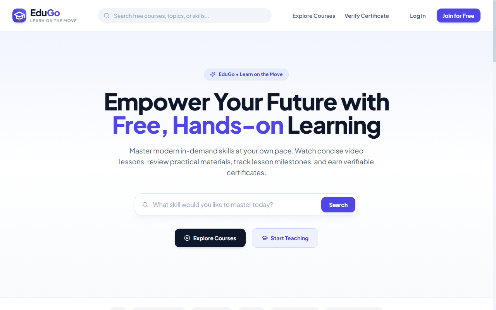
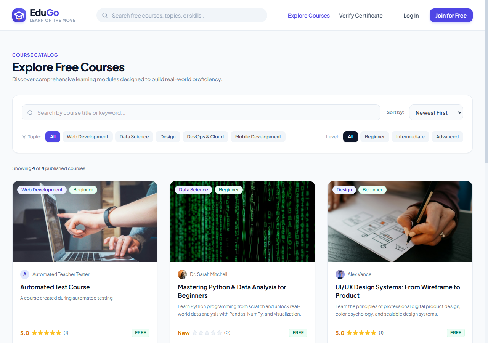
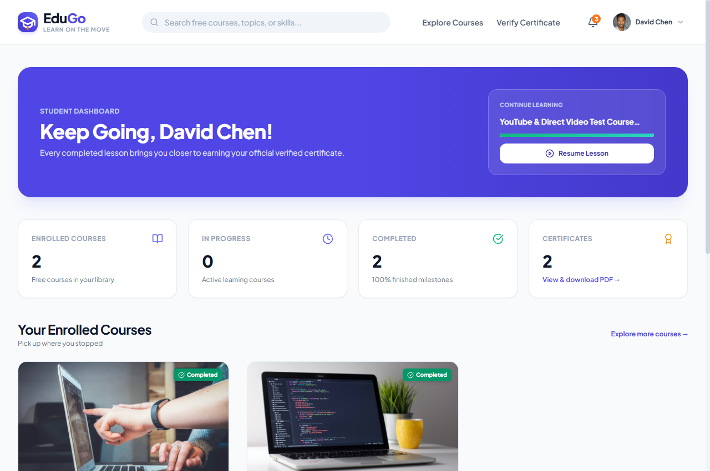
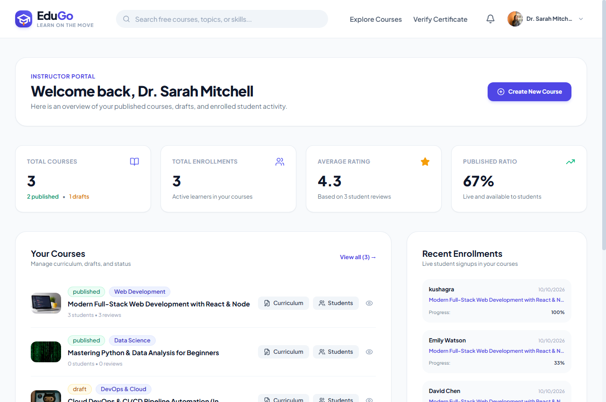
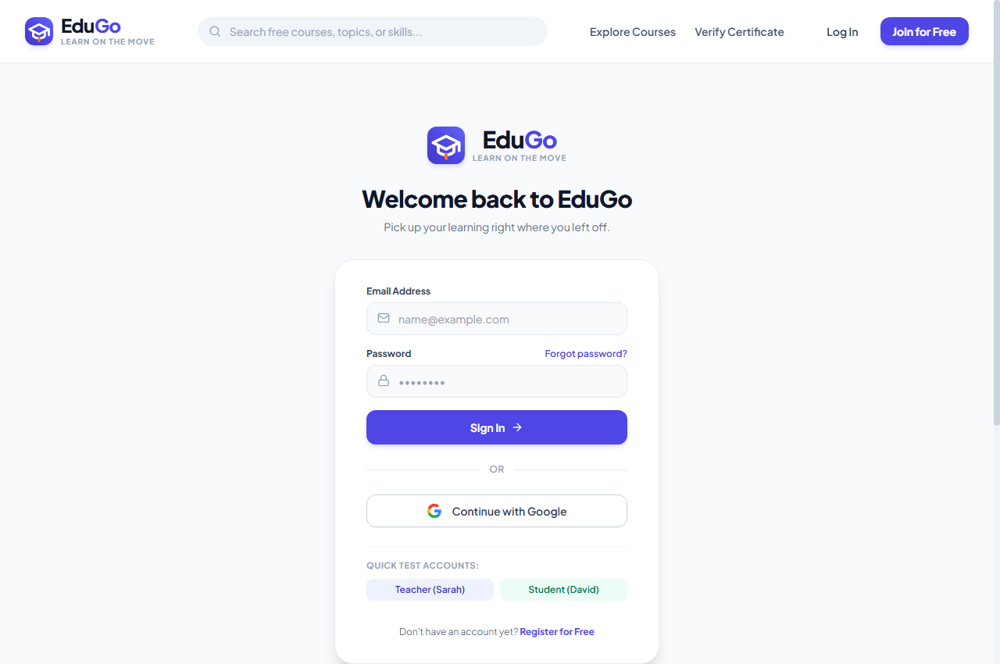
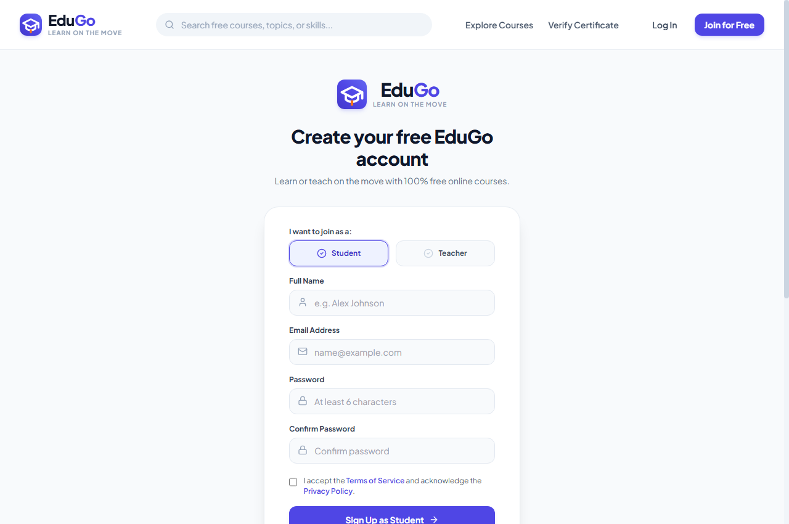
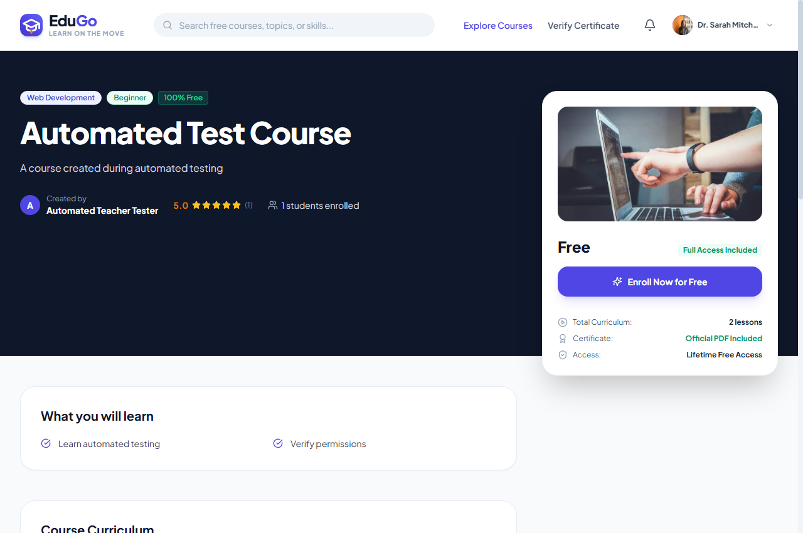
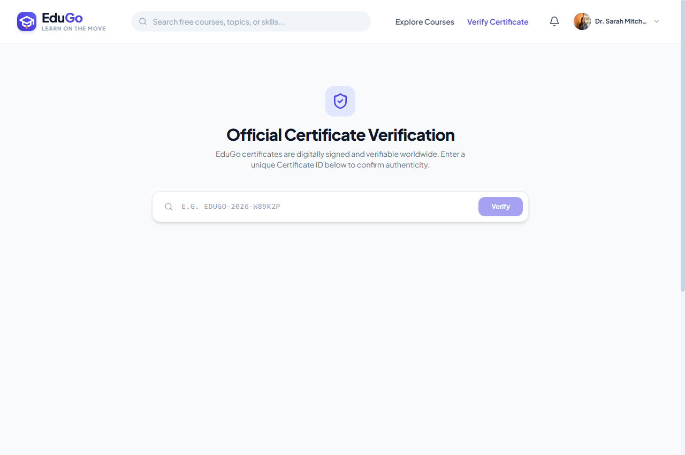

# EduGo — Learn on the Move

> **EduGo** is a full-stack, 100% free online learning platform built for learners and educators everywhere.
> **Tagline:** *Learn on the Move*  
> **Repository:** [https://github.com/KushagraG22/EduGo-E-Learning-Platform](https://github.com/KushagraG22/EduGo-E-Learning-Platform)

---

## 🌟 Highlights & Key Features

- **Strict Two-Role System:** Role-based access control for **Students** and **Teachers**. No quizzes or assessments anywhere in the platform; course completion is determined purely by verified milestone completion of required curriculum lessons.
- **100% Free Learning:** All published courses are permanently free to enroll in with no subscriptions or paywalls.
- **Curriculum Architecture:** Support for **Video Lessons** (YouTube and direct MP4/WebM/HLS streams), readable **Text Lessons**, and downloadable **Resource Files** organized into ordered sections.
- **Backend-Driven Progress Tracking:** Secure milestone calculation formula:
  $$\text{Progress} = \frac{\text{Completed Required Lessons}}{\text{Total Required Lessons}} \times 100$$
- **Automatic PDF Certificate Generation:** Generated on the backend with unique verification IDs and public verification portal (`/verify/:certificateId`).
- **In-App Notifications:** Real-time badge indicators, mark as read, and broadcasts when teachers post announcements.
- **Genuine Reviews & Ratings:** Only enrolled students can review courses (1 review per student per course), automatically computing real average ratings.
- **Public Teacher Profiles:** Dedicated instructor portfolios showcasing published courses and aggregate review metrics.
- **Private Student Profiles:** Strict learner privacy protection; student accounts and learning histories remain completely private.

---

## 📸 Application Screenshots

Genuine captures of the running application from `docs/screenshots/`:

| Homepage | Course Catalog & Search |
| :---: | :---: |
|  |  |
| *Hero discovery, search bar, and platform introduction* | *Filter by topic, difficulty level, and keywords* |

| Student Learning Dashboard | Instructor / Teacher Portal |
| :---: | :---: |
|  |  |
| *Active enrollments, progress milestones, and certificates* | *Course management, enrollment metrics, and draft status* |

| Sign In (with Google OAuth) | Sign Up (Role Switcher) |
| :---: | :---: |
|  |  |
| *Email/password + Continue with Google OAuth* | *Join as Student or Teacher with role safeguards* |

| Course Details & Curriculum | Public Certificate Verification |
| :---: | :---: |
|  |  |
| *Curriculum outline, instructor bio, and instant enroll* | *Publicly verify authenticity of any issued PDF* |

---

## 🛠️ Technology Stack

### Frontend
- **Framework:** React 18 with TypeScript
- **Build Tool:** Vite
- **Styling:** Tailwind CSS (Plus Jakarta Sans typography, sleek modern design system)
- **Routing:** React Router v6
- **Icons:** Lucide React
- **API Client:** Axios with JWT auto-injection

### Backend
- **Runtime:** Node.js (LTS v18+ / v20 / v24)
- **Framework:** Express.js with TypeScript
- **Database:** MongoDB with Mongoose ODM
- **Validation:** Zod schemas
- **Authentication:** JWT tokens, bcryptjs hashing, Google Identity Services (GSI) & OAuth2
- **Certificate Engine:** PDFKit (vector graphics, decorative borders, typography)
- **Media Engine:** Storage adapter supporting Cloudinary with local `/uploads` fallback
- **Email Engine:** Nodemailer with automated development test fallback and production SMTP

---

## 📂 Project Architecture

```
E-Learning Platform/
├── client/                     # Frontend React & Vite application
│   ├── public/
│   ├── src/
│   │   ├── components/
│   │   │   ├── auth/           # GoogleLoginButton, OAuth handlers
│   │   │   ├── common/         # Navbar, Footer, Logo, Modal, RatingStars, etc.
│   │   │   ├── course/         # CourseCard, filters, curriculum items
│   │   │   ├── layout/         # MainLayout, ProtectedRoute
│   │   │   └── player/         # VideoPlayer (YouTube, MP4, WebM, HLS)
│   │   ├── context/            # AuthContext, NotificationContext
│   │   ├── pages/
│   │   │   ├── public/         # Home, Explore, Details, Teacher Profile, Auth, Verification
│   │   │   ├── teacher/        # Dashboard, My Courses, Create/Edit, Curriculum, Announcements
│   │   │   └── student/        # Dashboard, My Learning, Player, History, Certificates
│   │   ├── services/           # Axios API client
│   │   ├── types/              # Full TypeScript contracts
│   │   └── utils/              # Video detection and player utilities
│   ├── index.html
│   ├── tailwind.config.js
│   └── vite.config.ts
├── server/                     # Backend Node.js & Express REST API
│   ├── src/
│   │   ├── config/             # MongoDB connection, env loader
│   │   ├── controllers/        # Auth, Courses, Curriculum, Enrollments, Progress, Reviews
│   │   ├── middleware/         # Authenticate, Authorize roles, Error handler, Rate limiting
│   │   ├── models/             # User, Course, Section, Lesson, Enrollment, Certificate, etc.
│   │   ├── routes/             # RESTful API route mounts
│   │   ├── services/           # PDF certificate generator, email service, storage service
│   │   ├── tests/              # Automated backend test suite with Vitest & Supertest
│   │   └── utils/              # Database seeder script, logger, JWT helpers
│   ├── uploads/                # Local uploaded assets & generated certificates (git-ignored)
│   └── tsconfig.json
├── docs/
│   └── screenshots/            # Authentic captures of the running platform
├── .env.example                # Safe template of all environment variables
├── .gitignore                  # Git exclusions for secrets, builds, and artifacts
├── package.json                # Root automation scripts
└── README.md                   # Complete documentation
```

---

## 🚀 Quick Start Guide

### 1. Prerequisites
- **Node.js** (v18 or higher; LTS recommended)
- **MongoDB** (Local MongoDB Server running on `mongodb://127.0.0.1:27017` or a [MongoDB Atlas](https://www.mongodb.com/cloud/atlas) connection string)
- **npm** (comes with Node.js)

---

### 2. Environment Variables Configuration
Copy the provided `.env.example` to `.env` in the root (or configure inside `server/`):

```bash
cp .env.example .env
```

| Variable | Default Value | Description |
| :--- | :--- | :--- |
| `PORT` | `5000` | Port for Express API |
| `NODE_ENV` | `development` | Environment mode (`development` or `production`) |
| `CLIENT_URL` | `http://localhost:5173` | Allowed origin for frontend application |
| `PUBLIC_URL` | `http://localhost:5000` | Public backend host URL |
| `MONGODB_URI` | `mongodb://localhost:27017/edugo` | MongoDB connection URI |
| `JWT_SECRET` | *(Random secure string)* | Secret key used to sign JWT authentication tokens |
| `JWT_EXPIRES_IN`| `7d` | Lifetime of authentication tokens |
| `GOOGLE_CLIENT_ID`| *(Optional)* | Google Cloud OAuth Client ID for Google Sign-In |
| `GOOGLE_CLIENT_SECRET`| *(Optional)* | Google Cloud OAuth Client Secret |
| `SMTP_HOST` | *(Optional)* | SMTP server host (e.g. `smtp.gmail.com`, `smtp.mailtrap.io`) |
| `SMTP_PORT` | `587` | SMTP server port (`587` for TLS, `465` for SSL) |
| `SMTP_USER` | *(Optional)* | SMTP account email / username |
| `SMTP_PASS` | *(Optional)* | SMTP account password / Google App Password |
| `EMAIL_FROM` | `EduGo <no-reply@edugo.org>` | Sender display name and address |
| `CLOUDINARY_CLOUD_NAME`| *(Optional)* | Cloudinary cloud name for remote media hosting |
| `CLOUDINARY_API_KEY`| *(Optional)* | Cloudinary API Key |
| `CLOUDINARY_API_SECRET`| *(Optional)* | Cloudinary API Secret |

---

### 3. Database Configuration

#### Option A: Local MongoDB
1. Ensure your local MongoDB service is running:
   ```bash
   mongod
   ```
2. The default `MONGODB_URI` is:
   ```env
   MONGODB_URI=mongodb://localhost:27017/edugo
   ```

#### Option B: MongoDB Atlas (Cloud)
1. Create a free cluster on [MongoDB Atlas](https://www.mongodb.com/cloud/atlas).
2. Create a database user and allow your IP in Network Access (`0.0.0.0/0` for cloud).
3. Set your connection string in `.env`:
   ```env
   MONGODB_URI=mongodb+srv://<username>:<password>@cluster0.mongodb.net/edugo?retryWrites=true&w=majority
   ```

---

### 4. Installation

Install dependencies across the root, client, and server:

```bash
# In project root
npm install

# In server directory
cd server && npm install

# In client directory
cd ../client && npm install
```

---

### 5. Seed the Database

Populate realistic sample teachers, students, published courses, curriculum modules, reviews, announcements, and certificates:

```bash
npm run seed --prefix server
```

#### Pre-configured Test Accounts:
- **Teacher Account:**
  - Email: `sarah.teacher@edugo.org`
  - Password: `Password123!`
- **Student Account:**
  - Email: `david.student@edugo.org`
  - Password: `Password123!`

---

### 6. Running the Application Locally

#### Option A: Run Both Concurrently (Recommended)
From the project root:
```bash
npm run dev
```

#### Option B: Run Frontend and Backend Separately
- **Start Backend:**
  ```bash
  npm run dev --prefix server
  ```
  Backend runs at: [http://localhost:5000](http://localhost:5000)  
  API Health check: [http://localhost:5000/api/health](http://localhost:5000/api/health)

- **Start Frontend:**
  ```bash
  npm run dev --prefix client
  ```
  Frontend runs at: [http://localhost:5173](http://localhost:5173)

---

### 7. Google OAuth Setup Guide

EduGo integrates genuine Google OAuth using both Google Identity Services (GSI ID token verification) and standard OAuth2 authorization code flows.

To enable live Google login with real Google accounts:
1. Go to the [Google Cloud Console](https://console.cloud.google.com/).
2. Create a new project (e.g., `EduGo E-Learning`).
3. Navigate to **APIs & Services > OAuth consent screen**:
   - Choose User Type: **External**.
   - Fill in App Name (`EduGo`), User support email, and Developer contact information.
   - Add scopes: `.../auth/userinfo.email` and `.../auth/userinfo.profile`.
4. Navigate to **APIs & Services > Credentials**:
   - Click **Create Credentials > OAuth client ID**.
   - Application type: **Web application**.
   - Name: `EduGo Web Client`.
   - **Authorized JavaScript origins:**
     - `http://localhost:5173`
   - **Authorized redirect URIs:**
     - `http://localhost:5173/auth/google/callback`
5. Copy your **Client ID** and **Client Secret** into your `.env` file:
   ```env
   GOOGLE_CLIENT_ID=your-client-id.apps.googleusercontent.com
   GOOGLE_CLIENT_SECRET=your-client-secret
   ```
6. Restart the backend server. The "Continue with Google" button will now authenticate directly against your Google project.

---

### 8. Password Reset & Email (SMTP) Setup Guide

EduGo dispatches single-use, 1-hour expiring password reset links.

#### Option A: Gmail (Recommended for personal testing)
1. In your Google Account, enable **2-Step Verification**.
2. Go to **Security > App passwords**.
3. Create an app password for `EduGo Email`.
4. Configure your `.env`:
   ```env
   SMTP_HOST=smtp.gmail.com
   SMTP_PORT=587
   SMTP_USER=your-email@gmail.com
   SMTP_PASS=your-16-character-app-password
   EMAIL_FROM="EduGo <your-email@gmail.com>"
   ```

#### Option B: Mailtrap or Brevo (Recommended for team testing)
1. Create a free account on [Mailtrap.io](https://mailtrap.io/) or [Brevo.com](https://www.brevo.com/).
2. Copy your SMTP credentials to `.env`:
   ```env
   SMTP_HOST=sandbox.smtp.mailtrap.io
   SMTP_PORT=2525
   SMTP_USER=your-mailtrap-user
   SMTP_PASS=your-mailtrap-password
   ```

#### Option C: Automated Development Mode (Zero External Setup Required)
- When SMTP credentials are not configured, EduGo automatically routes emails through an Ethereal test inbox or in-memory dispatch tracker, logging preview links in development and allowing full local end-to-end testing without external mail accounts.

---

## 🧪 Automated Testing

EduGo includes a comprehensive automated test suite testing:
- Student & Teacher registration, role authorization, and duplicate email guards
- Google OAuth token validation and role escalation prevention
- Password reset email delivery, secure SHA-256 token hashing, 1-hour expiration, and single-use enforcement
- Course creation, draft hiding, and cross-course modification barriers
- Video playback detection (YouTube and direct video URLs)
- Free enrollment uniqueness
- Backend progress percentage calculation (required vs. optional lesson rules)
- Real-time PDF certificate issuance & public verification
- Student review submission & course rating recalculation
- Course deletion/archival with permanent preservation of enrolled student history and certificates

Run the automated test suite:

```bash
npm run test --prefix server
```

Result: **53 tests passing across 2 test suites**.

---

## 📦 Production Build

To test and compile production bundles for deployment:

```bash
npm run build
```

- The client bundles into `client/dist/` (minified, tree-shaken, CSS purged).
- The server compiles into `server/dist/` (strict TypeScript validation).

---

## 🔧 Troubleshooting

### 1. `MongoServerSelectionError: connect ECONNREFUSED 127.0.0.1:27017`
- **Cause:** Local MongoDB service is not started.
- **Fix:** Start MongoDB using `mongod` in your terminal or start the MongoDB service from Windows Services (`services.msc` > MongoDB Server). Alternatively, use a free cloud [MongoDB Atlas](https://www.mongodb.com/cloud/atlas) URI in your `.env`.

### 2. `Error: listen EADDRINUSE: address already in use :::5000` or `:::5173`
- **Cause:** A previous instance of the server or client is still running.
- **Fix (Windows):**
  ```powershell
  # Find and kill process on port 5000
  Get-Process -Id (Get-NetTCPConnection -LocalPort 5000).OwningProcess | Stop-Process -Force
  # Find and kill process on port 5173
  Get-Process -Id (Get-NetTCPConnection -LocalPort 5173).OwningProcess | Stop-Process -Force
  ```

### 3. Google Login shows "Configuration Required" modal
- **Cause:** `GOOGLE_CLIENT_ID` has not yet been set in `.env`.
- **Fix:** This is an intentional safeguard. Email/password authentication is fully active. To enable Google Sign-In, follow the [Google OAuth Setup Guide](#7-google-oauth-setup-guide).

### 4. Password reset form shows success but no email arrives
- **Cause:** In development mode without SMTP credentials, EduGo generates and dispatches emails via an automated test engine.
- **Fix:** If you need real emails sent to your personal inbox, add your Gmail App Password to `SMTP_USER` and `SMTP_PASS` in `.env` as explained in the [SMTP Setup Guide](#8-password-reset--email-smtp-setup-guide).

### 5. PowerShell script execution disabled (`npm` not recognized)
- **Fix (Windows):** Run PowerShell as Administrator or bypass for the current process:
  ```powershell
  Set-ExecutionPolicy -Scope Process -ExecutionPolicy Bypass
  $env:Path = "C:\Program Files\nodejs;$env:Path"
  ```

---

## 🔒 Security Best Practices Implemented

- **Password Hashing:** Passwords hashed using `bcryptjs` with salt rounds.
- **SQL/NoSQL Injection Protection:** Queries validated and parameterized through Mongoose schemas.
- **Input Sanitization:** Express request bodies validated with strict rules.
- **Ownership Verification:** Teachers cannot edit, delete, or modify courses belonging to another teacher.
- **Enrollment Access Control:** Unenrolled users cannot access restricted learning videos or lesson resources.
- **Student Privacy:** Student accounts, emails, and learning histories are kept strictly private; only valid certificates are viewable through their unique verification ID.
- **Rate Limiting:** Protection enabled on `/api/auth/login` and `/api/auth/forgot-password`.
- **Security Headers:** Configured with `helmet` with appropriate CORS and cross-origin resource policy.
